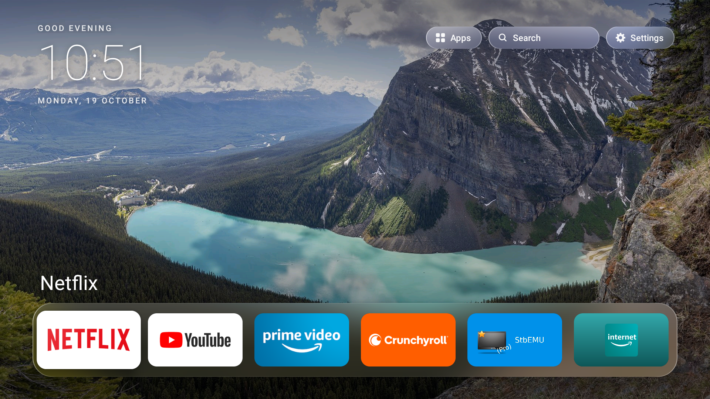
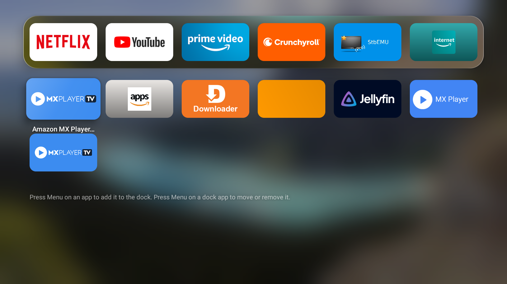

# Fire TV Stick debloat and TV Home

PowerShell scripts that strip ads, tracking and unused Amazon apps from a Fire TV Stick over ADB,
plus TV Home, a small Apple TV-style home screen. I built it for a Fire TV Stick 3rd gen (AFTSSS)
on Fire OS 7.7.1.6. Every change can be undone, and nothing Amazon ships gets uninstalled.

## Setup

1. Turn on ADB debugging on the TV (Settings > My Fire TV > Developer Options).
2. Put Google's Android tools in `tools\`: `platform-tools` (adb), build-tools 34 in
   `tools\sdk\android-14` and platform 30 in `tools\sdk\android-11`. They aren't in the repo.
3. Pass your TV's address to any script with `-Device 192.168.x.x:5555`. The default is the
   address of my TV.

Run the scripts in PowerShell from this folder. If the TV has gone to sleep, wake it with the
remote first, because the scripts reach it over Wi-Fi.

| Script | What it does |
| --- | --- |
| `backup-firetv.ps1` | Saves the package list and settings. The first backup (`backups\ORIGINAL`) is what restore uses. |
| `debloat-firetv.ps1 -Batch all` | Disables everything listed below. Safe to re-run; Fire OS turns Alexa's voice service back on at every boot. |
| `restore-firetv.ps1` | Puts the TV back the way the first backup found it. Run it with `-DryRun` first to see the list. `-KeepLauncher` keeps TV Home. |
| `build-launcher.ps1` / `install-launcher.ps1` | Build TV Home from `launcher\` and install it. Run them again after a Fire OS update. |
| `add-wallpapers.ps1 -Folder <path>` | Uses your own photos instead of the nature set. Also takes `-List`, `-Replace` and `-Reset`. |

## What gets disabled

Ads and tracking: viewing recognition (ACR), the advertising ID, sponsored previews, Shop the TV,
special offers, firmware, Wi-Fi and performance metrics, and logcat upload.

Amazon apps I don't use: Photos, Music, Music & More, Luna, the games hub, Amazon Kids and News.
Silk stays on because TV Home's search uses it.

Alexa voice: the media player, alerts, notifications and multi-room audio. Fire OS turns the core
voice service (`vizzini`) back on at each boot, so the mic button may keep working.

Updates: the forced-update and "easy upgrade" helpers. Device and app usage data upload is
switched off, and animations run at half length.

Prime Video, casting, screen mirroring, smart home/Matter and miniTV stay on. miniTV is
installed, but Fire OS hides it on a US-region account, in Amazon's own app list too.

Amazon marks a few packages as protected, so these stay on: ad deep-links, crash and log uploads,
customer-service data, and the main system updater. Updates can still arrive. If one breaks TV
Home, run `install-launcher.ps1` again, or `restore-firetv.ps1`.

## TV Home

The home screen shows a greeting, the clock and the date at the top left, with glass Apps,
Search and Settings buttons at the top right (press Up from the dock to reach them). The focused
app's name sits above a liquid-glass dock. Six apps fit in the dock and more scroll; press the
Menu button (☰) on a dock app to move or remove it.

Press Down on the dock, or choose Apps, and the dock slides to the top while every other app
appears below on a blurred wallpaper. Menu on one of those adds it to the dock. Up from the dock,
or Back, returns home.

Search filters your apps as you type. The keyboard's Search key, or the "Search the web" tile,
opens Bing results in Silk.

Nine nature photos from Wikimedia Commons rotate every 45 seconds and each time you come home.
Settings has shortcuts to Network, Display & Sounds, Applications, Bluetooth, Preferences,
Privacy, Accessibility, Account, My Fire TV and Amazon's quick menu (Sleep, Mirroring, Profiles),
plus Next Wallpaper and Wallpaper Credits. The clock follows the TV's 12/24-hour setting.

Fire OS only lets Amazon-signed apps take over the Home button, so Home still goes to Amazon's
screen first. TV Home covers it with a blurred copy of the wallpaper and takes over within about
1 to 2 seconds by pressing its own tile in Amazon's favourites row, so keep that tile first in
the row. Holding Home still opens Amazon's quick menu.

TV Home uses about 60 MB while on screen and about 35 MB while an app plays. Amazon's home can't
be switched off, but it now stays in the background (about 40 MB) instead of on screen (about
100 MB).

## Not in this repo

The `tools\` folder (Google's Android SDK), device backups, screenshots, build output and the
APK signing key stay local. `build-launcher.ps1` makes a new signing key if there isn't one, but
an APK signed with a new key won't install over one signed with the old key.

## Photo credits

The wallpapers in `launcher\assets\wallpapers` were cropped to 1920x1080 and keep their original
licences:

- Lake Louise, Canada. Photo: Chensiyuan, CC BY-SA 4.0
- Blue Lake, Mount Cook National Park, New Zealand. Photo: Krzysztof Golik, CC BY-SA 4.0
- Goðafoss, Iceland. Photo: Martin Falbisoner, CC BY-SA 4.0
- Beech and ferns, Gullmarsskogen, Sweden. Photo: W.carter, CC0
- Loch below Beinn Dorain, Scotland. Photo: Michal Klajban, CC BY-SA 4.0
- Vallée de Gavarnie, Pyrenees, France. Photo: Moahim, CC BY-SA 4.0
- November fog on the Uetliberg, Switzerland. Photo: Kuhnmi, CC BY-SA 4.0
- Dawn on Lago do Cuniã, Brazil. Photo: RodrigoErse, CC BY-SA 4.0
- Gullfoss, Iceland. Photo: Pierre-Selim Huard, CC BY 4.0
